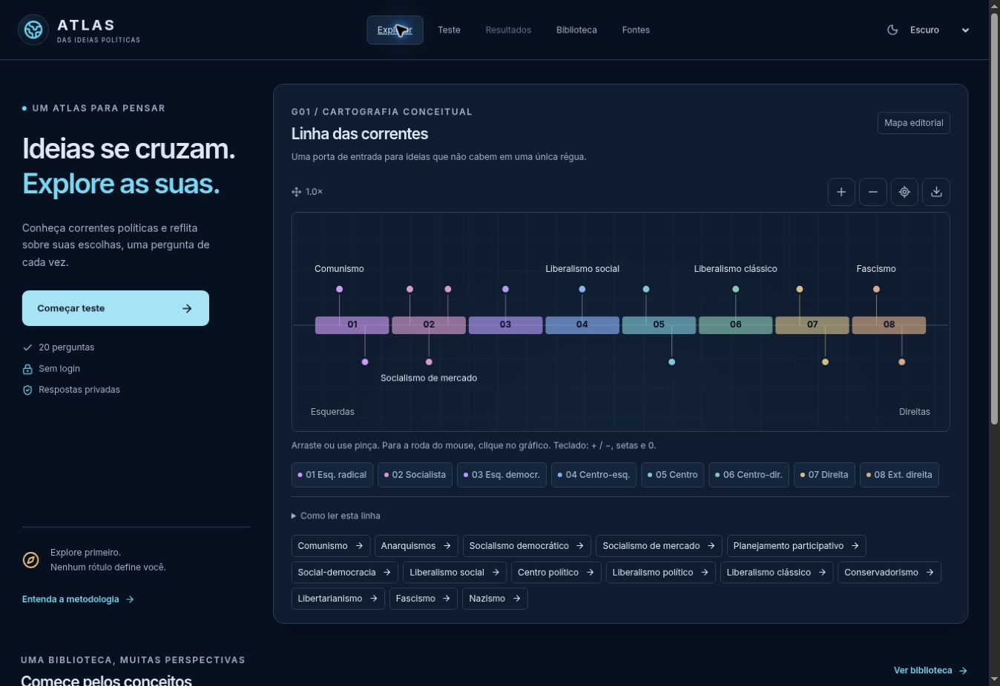

# Atlas das Ideias Políticas

## 🌐 [ABRIR O DASHBOARD NO NAVEGADOR](https://alldevitone-maker.github.io/atlas-ideias-politicas/)

**É só clicar no link acima. Funciona sem conta, sem instalar nada e sem baixar o código.**

Um projeto educativo em português para conhecer correntes políticas e refletir sobre escolhas em situações do cotidiano. Você pode explorar uma biblioteca de conceitos, responder a 20 perguntas e consultar um relatório com gráficos e as alternativas que escolheu.

[Como usar](#como-usar-passo-a-passo) · [Entenda os gráficos](#entenda-os-gráficos) · [Privacidade](#privacidade) · [Testes e documentação](#testes-e-documentação)



## Como usar, passo a passo

1. **[Abra o Atlas](https://alldevitone-maker.github.io/atlas-ideias-politicas/).** A primeira tela já mostra o mapa de ideias. Você pode explorá-lo antes de responder qualquer pergunta.
2. **Clique em “Começar teste”.** Informe um nome de exibição se quiser. O campo é opcional; não é cadastro.
3. **Leia cada cenário e escolha uma alternativa.** Use “Próxima” para avançar, “Anterior” para voltar ou “Pular sem responder”. A opção “Não sei / prefiro não responder” também é válida.
4. **Revise suas escolhas.** Clique em “Revisar” ou termine as 20 perguntas para abrir a revisão. Use “Editar Q01”, por exemplo, para voltar à pergunta correspondente.
5. **Clique em “Ver meu relatório”.** O dashboard apresenta suas escolhas, temas respondidos, lacunas e relações entre alguns cenários. É possível consultar um relatório parcial com pelo menos uma alternativa preenchida.
6. **Guarde o que quiser.** “PDF resumido” e “PDF completo” geram arquivos no seu navegador. Os controles dos gráficos permitem ampliar, recentrar e exportar SVG.
7. **Continue explorando.** Abra “Biblioteca” para conhecer os conceitos e “Fontes” para consultar as referências. “Editar respostas” permite revisar; “Refazer teste” inicia outra tentativa após confirmação.

**Atenção ao progresso:** navegar pelo menu mantém as respostas, mas atualizar a página ou fechar a aba apaga o teste. Baixe o PDF antes de sair se quiser guardar o relatório.

### Dicas para navegar

- No celular, abra o menu pelo ícone no topo para acessar Teste, Resultados, Biblioteca e Fontes.
- Use “Tema visual” para escolher Claro, Escuro ou Sistema.
- No mapa de correntes, use os botões de zoom, arraste a área ou faça o gesto de pinça. Com o gráfico em foco, o teclado aceita `+`, `-`, setas e `0` para recentrar.
- Clique em uma corrente ou em sua lista equivalente para ler a definição, as diferenças e as fontes. As faixas numeradas aprofundam o mapa.
- “Resultados” fica disponível depois de preencher uma alternativa. Se o relatório estiver vazio após atualizar a página, o progresso temporário foi apagado.

## Para que serve o projeto

O Atlas reúne estudo e autorreflexão em uma interface acessível pelo navegador. A proposta é tornar visíveis as escolhas e seus limites, com conceitos e regras que podem ser consultados no código.

- **Biblioteca introdutória:** 14 verbetes sobre correntes políticas, com definições, variações e referências oficiais ou acadêmicas.
- **Questionário exploratório:** 20 cenários com revisão das alternativas, possibilidade de omissão e distinção entre posição declarada, condição e incerteza.
- **Dashboard:** seis visualizações com explicações e alternativas em texto ou tabela.
- **Exportação local:** relatório resumido, relatório completo e gráficos em SVG.
- **Interface responsiva:** temas claro e escuro, navegação por teclado e adaptação a diferentes larguras de tela.

O questionário é **exploratório e não possui validação psicométrica**. O relatório descreve respostas a cenários hipotéticos. Não calcula porcentagem de identidade ideológica, não recomenda partido ou voto e não classifica extremismo. A biblioteca e o mapa têm escolhas editoriais discutíveis e não esgotam o assunto.

## Entenda os gráficos

- **G01, linha das correntes:** organiza conceitos em faixas editoriais para facilitar o estudo. A posição no desenho não é uma medida universal.
- **G02, economia:** cruza as categorias escolhidas nas perguntas Q14 e Q19. Se faltarem respostas determinadas, a combinação não é destacada.
- **G03, evidências por tema:** conta os tipos de resposta e permite voltar às perguntas que sustentam a leitura.
- **G04, cobertura por tema:** mostra quanto foi respondido. Não mede intensidade da crença.
- **G05, matriz de respostas:** relaciona perguntas, temas e estados das alternativas.
- **G06, relações entre cenários:** apresenta três comparações com regras públicas. Diferenças entre situações não são diagnóstico de incoerência ou parcialidade.

Questões puladas continuam ausentes. “Depende” e “não sei” não são convertidos em centro político. Cada leitura deve ser conferida junto ao cenário original.

## Privacidade

As respostas ficam apenas na memória desta aba. Não há conta, banco de dados de respostas, analytics ou envio das alternativas a um servidor. PDFs e SVGs são gerados localmente quando você solicita.

O tema visual pode ser salvo no dispositivo. O nome só é salvo se você marcar “Lembrar meu nome neste dispositivo”; pessoas que usam o mesmo dispositivo poderão vê-lo. “Esquecer meu nome” remove esse nome. “Apagar todos os dados” remove respostas e nome após confirmação, mas não elimina PDFs já baixados.

O GitHub Pages pode processar dados técnicos de acesso ao entregar os arquivos. As escolhas do questionário não são incluídas nessas requisições. As referências externas têm suas próprias políticas quando você abre seus links.

## Testes e documentação

- [Publicação concluída no GitHub Pages](https://github.com/alldevitone-maker/atlas-ideias-politicas/actions/runs/39892345207), com verificações de formato, lint, TypeScript, testes unitários, build e testes de navegador antes do deploy.
- [QA e limitações da validação](docs/QA.md).
- [Metodologia e auditoria editorial](docs/AUDITORIA_EDITORIAL.md).
- [PDF resumido de demonstração](docs/evidence/demo-resumo.pdf) e [PDF completo de demonstração](docs/evidence/demo-completo.pdf), com respostas fictícias identificadas.
- [Capturas de tela e checagens de layout](docs/evidence).

<details>
<summary><strong>Para quem quer desenvolver ou contribuir</strong></summary>

React, TypeScript estrito, Vite, Tailwind, D3/SVG, Radix e geração de PDF sob demanda. Node 24 e npm; dependências fixadas pelo `package-lock.json`.

```sh
npm ci
npm run dev
```

O ambiente local abre em `http://127.0.0.1:5173/atlas-ideias-politicas/`. A aplicação usa rotas por hash para funcionar na hospedagem estática.

```sh
npm run format:check
npm run lint
npm run typecheck
npm run test:unit
npm run build
npx playwright install --with-deps chromium firefox webkit
npm run test:e2e
npm run check:links
```

Perguntas, fontes e verbetes ficam em `src/data`; as regras, em `src/domain/model.ts`; a interface, em `src/App.tsx` e `src/components`; os testes, em `src/tests` e `e2e`. As fontes tipográficas são locais, com suas licenças em `docs`.

A publicação é manual: **Actions → Publish V1 to Pages → Run workflow → main**. O workflow executa a validação antes de publicar `dist`. Alterar o README não exige republicar a aplicação.

As especificações recebidas estão preservadas em `docs/00…13` como histórico de planejamento. Para funcionalidades entregues e limitações, consulte este README e o QA.

</details>

Código original sob licença MIT. As referências bibliográficas pertencem a seus respectivos autores; sua inclusão não implica licença sobre os conteúdos citados.
